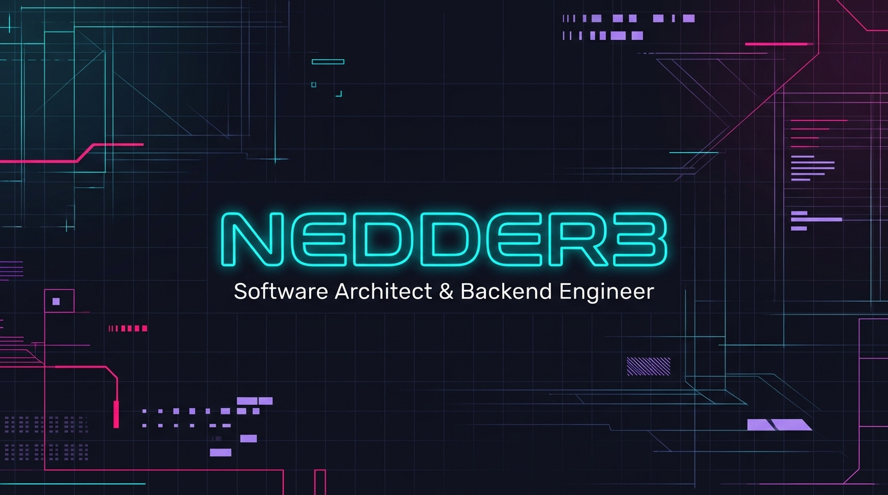

<!-- Banner -->
<div align="center">
  
  
  <h1>Ariel Jaime</h1>
  <p><strong>Senior Backend Engineer & Distributed Systems Architect</strong></p>
  <p><i>Designing resilient, high-concurrency distributed primitives with zero-compromise correctness.</i></p>

  <p>
    <a href="https://linkedin.com/in/ariel-jaime/"></a>
    <a href="https://nedder3.github.io"></a>
    <a href="mailto:arij.dev@gmail.com"></a>
    
  </p>

  <p>
    
    
    
    
    
  </p>
</div>

---

### Executive Profile

Senior Backend Engineer with **10+ years in IT and 6+ years specializing in Java enterprise ecosystems and distributed systems architecture**. Proven track record designing low-latency, mission-critical infrastructure components (distributed caches, consensus mechanisms, async lock-free event routers). 

Currently serving as **Squad Senior / Tech Lead & Mentor at Teamcubation**, delivering high-impact technical training to developers (including senior engineers with 15+ years experience) across modern software architecture, microservices, concurrency models, and agentic AI systems.

- **Distributed Systems & Concurrency:** Hexagonal architecture, CQRS / Event Sourcing, Vector Clocks, Write-Ahead Logs (WAL), CAS lock-free structures, and Java 21 Virtual Threads.
- **Enterprise Track Record:** Designed and maintained mission-critical Spring Boot microservices for tier-1 enterprises (Sancor Salud, MercadoLibre training programs, Banco Santander, Globant).
- **Technical Mentorship:** Mentored 100+ engineers, authoring production-grade curricula covering Clean Architecture, Reactive Systems, Virtual Threads, and Agentic Engineering.

---

### Core Competencies & Tech Stack

```
Runtime & Languages    : Java 21 LTS (Virtual Threads, Records, Sealed Types), Python 3.12, TypeScript, SQL
Frameworks & Core      : Spring Boot 3, Spring Security (OAuth2/JWT/OIDC), JPA/Hibernate, .NET Core
Distributed Systems    : Vector Clocks, W-TinyLFU, WAL + CRC32, CQRS/ES, Outbox Pattern, Event-Driven Architecture
Messaging & Storage    : Apache Kafka, Redis, PostgreSQL, SQLite, MongoDB
Infra, Cloud & DevOps  : Docker, AWS (S3, IAM, Lambda, EC2), GitHub Actions, CI/CD, Linux
Methodologies          : TDD (JUnit 5, Mockito, AssertJ), Clean Architecture, Domain-Driven Design (DDD)
```

---

### Flagship Engineering Projects

#### 1. [distributed-cache-engine](https://github.com/nedder3/distributed-cache-engine)
*Distributed, fault-tolerant in-memory key-value cache engine built from scratch with Java 21.*
- **Architecture:** Ports & Adapters (Hexagonal Architecture) with explicit CQRS/ES write/read path separation.
- **Consistency & Recovery:** Vector Clocks for causality tracking and conflict resolution; append-only Write-Ahead Log (WAL) with CRC32 checksums and asynchronous checkpointing.
- **Eviction & Storage:** High-throughput eviction engine pairing W-TinyLFU with Count-Min Sketch frequency estimation for optimal hit rates under dynamic workloads.
- **Concurrency & Rigor:** Built with Java 21 Virtual Threads and thread-safe lock striping. Tested with **359 comprehensive automated unit and integration tests** ensuring zero concurrency races.

#### 2. [java-event-bus](https://github.com/nedder3/java-event-bus)
*High-throughput, asynchronous in-memory event bus designed for modular monoliths.*
- **Non-Blocking Core:** Atomic CAS operations and non-blocking queues (`ConcurrentLinkedQueue`) eliminating synchronization bottlenecks on high-frequency hot paths.
- **Bounded Backpressure:** Configurable backpressure strategies (`REJECT` via exceptions or `DROP` with drop-rate observability metrics).
- **Dispatch Strategies:** Configurable fan-out multicasting or round-robin consumer balancing with `CompletableFuture` coordination.
- **Quality Assurance:** **42 multi-threaded concurrency stress tests** validating zero event loss and strict deterministic delivery.

#### 3. [tq-labs](https://github.com/nedder3/tq-labs)
*Developer technical platform & internal learning management engine.*
- Full-stack SSR architecture utilizing Astro, Supabase (PKCE auth, Row-Level Security), and Vercel.
- Features dynamic markdown labs, progress tracking, and **174 automated Vitest tests** covering auth, database isolation, and rendering pipelines.

---

### Professional Trajectory Snapshot

| Period | Role | Organization & Scope |
|---|---|---|
| **08/2025 – Present** | **Squad Senior / Tech Lead & Mentor** | **Teamcubation** — Technical mentoring for devs and senior engineers (15+ yrs); curriculum design across Java 21, Spring Boot, Microservices, and Agentic AI. |
| **01/2024 – 06/2024** | **Programming Mentor** | **Alkemy** — Led technical mentorship for the **MercadoLibre** Java Spring Boot bootcamp; oversaw comprehensive production-ready capstone architectures. |
| **11/2023 – 01/2024** | **Backend Developer** | **Right Partner** — Engineered mission-critical REST microservices in Java Spring Boot for **Sancor Salud** healthcare domain. |
| **01/2021 – 11/2022** | **Backend Teacher & Lead** | **Digital House** — Delivered intensive backend engineering training for top accounts (**MercadoLibre, Banco Santander, Globant, Sabre, Xpertal**). |
| **01/2020 – 01/2021** | **Application Developer** | **Bernardo Lew** — Core Java, Spring Boot, MySQL/PostgreSQL/MongoDB development for enterprise management systems and lab routing equipment. |
| **01/2017 – 01/2020** | **Software Developer** | **Freelance** — Desktop and web client solutions with C#, .NET, MySQL, and full-stack web platforms. |

---

### GitHub Activity & Metrics

<div align="center">
  
  &nbsp;&nbsp;
  
</div>

<br/>

<div align="center">
  <p>📍 Bahía Blanca, Buenos Aires, Argentina &nbsp;|&nbsp; 🌐 Open to Worldwide Remote Opportunities (USD)</p>
  <p><small>Engineered with rigor and verifiable architectural principles.</small></p>
</div>
