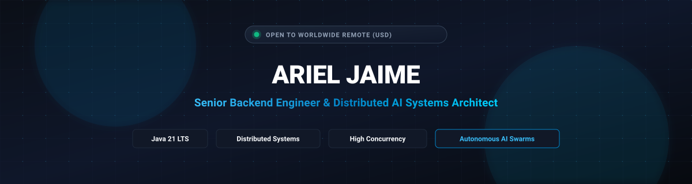

<!-- Hero Header -->
<div align="center">
  
  <br/><br/>

  <!-- Social & Verified Credentials -->
  <p>
    <a href="https://linkedin.com/in/ariel-jaime/"></a>
    <a href="https://nedder3.github.io"></a>
    <a href="mailto:arij.dev@gmail.com"></a>
    <a href="https://cert.efset.org/score/quickcheck/70?source=EF%20SET&cid=ss011"></a>
  </p>

  <!-- Unified Dark Architecture Badges -->
  <p>
    
    
    
    
    
    
  </p>
</div>

---

### Executive Profile

Senior Backend Engineer and Distributed AI Systems Architect with **10 years of software engineering experience**, specializing for the past **6+ years in enterprise Java ecosystems, high-concurrency architectures, and distributed systems**. Proven track record architecting low-latency, fault-tolerant infrastructure components alongside **production-grade autonomous multi-agent AI swarms and knowledge graphs**.

Currently serving as **Squad Senior / Tech Lead & Technical Mentor at Teamcubation**, leading engineering squads and coaching senior developers (10+ years industry experience) across modern cloud architectures, Java 21, and agentic engineering workflows.

- **Distributed Systems & Concurrency:** Hexagonal architecture (Ports & Adapters), CQRS / Event Sourcing, Vector Clocks for causal ordering, Write-Ahead Logging (WAL) with CRC32 integrity, lock-free CAS primitives, and Java 21 Virtual Threads.
- **Autonomous AI & Agentic Engineering:** Architected local 8-agent autonomous swarms with strict Single Responsibility Principles (SRP), automated Red/Green TDD quality gates, semantic knowledge graphs exceeding 33,000 nodes, and anti-hallucination deterministic extraction pipelines.
- **Enterprise Track Record:** Engineered microservices and led technical acceleration programs for tier-1 enterprises (**Sancor Salud, MercadoLibre training programs, Banco Santander, Globant**).
- **Technical Leadership:** Mentored 100+ engineers, authoring enterprise curricula covering 18 specialized backend modules (Clean Architecture, Concurrency, Virtual Threads, Copilot Studio, Claude, and local LLM orchestration via Ollama).

---

### Core Competencies & Tech Stack

```text
Backend Core           : Java 21 LTS (Virtual Threads, Records, Sealed Types), Python 3.12, TypeScript, SQL, C#
Frameworks & APIs      : Spring Boot 3, Spring Security (OAuth2/JWT/OIDC), JPA/Hibernate, .NET Core, FastAPI, RESTful APIs
Distributed Systems    : Hexagonal Architecture, CQRS & Event Sourcing, Vector Clocks, WAL + CRC32, W-TinyLFU, Microservices
AI & Agentic Systems   : Multi-Agent Swarm Orchestration (Hermes), Knowledge Graph RAG (33k+ nodes), Local LLMs (Ollama)
                         Deterministic Anti-Hallucination Pipelines, Microsoft Copilot Studio, Claude, Prompt Engineering
Data & Messaging       : Apache Kafka, Redis, PostgreSQL, MySQL, MongoDB, SQLite
Infra, Cloud & DevOps  : Docker, AWS (S3, IAM, Lambda, EC2), GitHub Actions, CI/CD, Linux CLI
Engineering Rigor      : Test-Driven Development (TDD), JUnit 5, Mockito, AssertJ, Vitest, Concurrency Stress Testing
```

---

### Featured Architectural & AI Engineering Projects

#### 1. Distributed Infrastructure & High-Concurrency Core

<div align="center">
  <a href="https://github.com/nedder3/distributed-cache-engine">
    
  </a>
  &nbsp;&nbsp;
  <a href="https://github.com/nedder3/java-event-bus">
    
  </a>
</div>

<br/>

* **[distributed-cache-engine](https://github.com/nedder3/distributed-cache-engine)** *(Java 21 · Concurrency · Distributed Systems · 359 Automated Tests)*
  * **Architecture:** Ports & Adapters (Hexagonal Architecture) with explicit CQRS write/read path segregation.
  * **Consistency & Recovery:** Vector Clocks for causality tracking across active-active nodes; append-only Write-Ahead Log (WAL) with CRC32 checksums and point-in-time snapshot recovery.
  * **Eviction Engine:** W-TinyLFU eviction backed by a Count-Min Sketch frequency estimation filter.
  * **Concurrency & Verification:** Built with Java 21 Virtual Threads and lock striping. Verified by **359 automated unit, integration, and multi-threaded stress tests** asserting zero race conditions.

* **[java-event-bus](https://github.com/nedder3/java-event-bus)** *(Java 21 · High Throughput · Non-Blocking CAS · 42 Stress Tests)*
  * **Non-Blocking Core:** Atomic CAS operations and non-blocking queues (`ConcurrentLinkedQueue`) eliminating thread contention on high-frequency paths.
  * **Bounded Backpressure:** Configurable backpressure strategies (`REJECT`, `BLOCK`, `DROP_OLDEST` with drop-rate observability metrics).
  * **Dispatch Coordination:** Configurable fan-out multicasting or round-robin balancing using `CompletableFuture` asynchronous dispatch.
  * **Quality Assurance:** **42 multi-threaded concurrency stress tests** validating zero event loss under heavy producer/consumer contention.

---

#### 2. Enterprise Autonomous AI & Knowledge Systems

* **[Hermes Multi-Agent Autonomous Swarm Architecture](https://nedder3.github.io/projects/hermes-agent-swarm)** *(Agentic AI · Python · Ollama · TDD Quality Gates)*
  * **Specialized Swarm Roles:** 8 distinct agent personas (Orchestrator, TDD Red-Tester, Backend Implementer, Visual Designer, Security/A11y Auditor, Deployer, Curator) governed by strict Single Responsibility (SRP).
  * **Red/Green Quality Gates:** Implements mandatory Red-TDD phase before code generation, with blind automated CLI verification gates prior to deployment.
  * **Inference Resilience:** Designed serial scheduling algorithms preventing VRAM thrashing on local models (Ollama) and eliminating upstream HTTP 503 concurrency errors.
  * **Knowledge Graph RAG:** Integrated a 33,000+ node semantic knowledge graph (Graphify) for contextual cross-agent retrieval without prompt overflow.

* **[Deterministic ROI Automation Engine](https://nedder3.github.io/projects/roi-analysis-engine)** *(Python · Deterministic Extraction · Anti-Hallucination · Teamcu Hackathon)*
  * **Anti-Hallucination Design:** Segregates LLM capabilities strictly to schema extraction, executing all financial calculations in deterministic Python code.
  * **Textual Evidence Links:** Every quantitative claim is linked to an immutable file location, speaker timestamp, and verbatim citation.
  * **Dynamic Rates:** Integrated with official Argentine Central Bank (BCRA) and RIPTE wage series APIs with stale-cache fallback.

* **[tq-labs](https://github.com/nedder3/tq-labs)** *(Astro · Supabase · TypeScript · 174 Vitest Tests)*
  * Developer learning engine featuring SSR, Supabase PKCE auth, Row-Level Security (RLS), dynamic markdown labs, and **174 automated Vitest tests** covering auth and rendering pipelines.

---

### Professional Trajectory Snapshot

| Period | Role | Organization & Scope |
|---|---|---|
| **08/2025 – Present** | **Squad Senior / Tech Lead & Mentor** | **Teamcubation** — Technical mentoring for engineering squads and senior developers (10+ yrs); enterprise backend curriculum (18 modules across Java 21, Spring Boot, Microservices, and Agentic AI workflows). |
| **01/2024 – 08/2025** | **Programming Mentor** | **Alkemy** — Led technical mentorship across recurring developer acceleration cohorts, culminating in **MercadoLibre's** Java Spring Boot engineering pipeline. |
| **11/2023 – 01/2024** | **Backend Developer** | **Right Partner** — Engineered mission-critical REST microservices in Java Spring Boot for healthcare enterprise client **Sancor Salud**. |
| **01/2021 – 11/2022** | **Backend Instructor & Tech Lead** | **Digital House** — Delivered intensive backend engineering training for top tier-1 accounts (**MercadoLibre, Banco Santander, Globant, Sabre, Xpertal**). |
| **01/2020 – 01/2021** | **Enterprise Application Developer** | **Bernardo Lew** — Core Java, Spring Boot, and multi-database development (MySQL, PostgreSQL, MongoDB) for enterprise software and clinical hardware routing. |
| **08/2015 – 01/2020** | **Software & Systems Developer** | **Freelance** — Architected bespoke commercial desktop applications and relational database schemas with C#, .NET, and MySQL. |

---

### GitHub Activity & Metrics

<div align="center">
  
  &nbsp;&nbsp;
  
</div>

<br/>

<div align="center">
  <p>📍 Bahía Blanca, Buenos Aires, Argentina &nbsp;|&nbsp; 🌐 Open to Worldwide Remote Opportunities (USD)</p>
  <p><small>Engineered with verifiable distributed systems principles, concurrency rigor, and autonomous AI swarms.</small></p>
</div>
